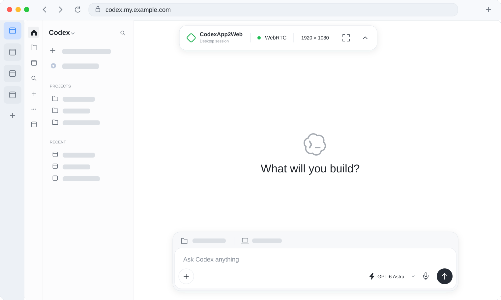

# CodexApp2Web

Turn the Codex desktop app into a web app accessible from a browser



- Captures the Codex UI and forwards input through the Chrome DevTools Protocol without requiring system screen-recording permission
- Streams lossless framebuffer updates using embedded TigerVNC and noVNC over WebRTC, with WebSocket as a fallback
- Proxies native Codex context menus so they can be used from the remote page

## Build and run

Requires a C++ compiler, CMake, pixman, libjpeg-turbo, Node.js and pnpm


```sh
git submodule update --init --recursive
cargo build --release
./target/release/codex-app2web --cdp-port 9341
```

The server listens on `127.0.0.1:8787` by default

Codex must be started with a CDP debugging port, for example:

```sh
open -na /Applications/ChatGPT.app --args --remote-debugging-address=127.0.0.1 --remote-debugging-port=9341
```

## Public access

This project does not provide user authentication

When exposing it to the public internet, keep it bound to a local address or Unix socket and place it behind a reverse proxy such as Caddy with an authentication service such as Authelia

TigerVNC is pinned to 1.16.0 and licensed under GPL-2.0-or-later; noVNC is pinned to 1.7.0 and licensed under MPL-2.0. The prototype links pixman and JPEG dynamically
